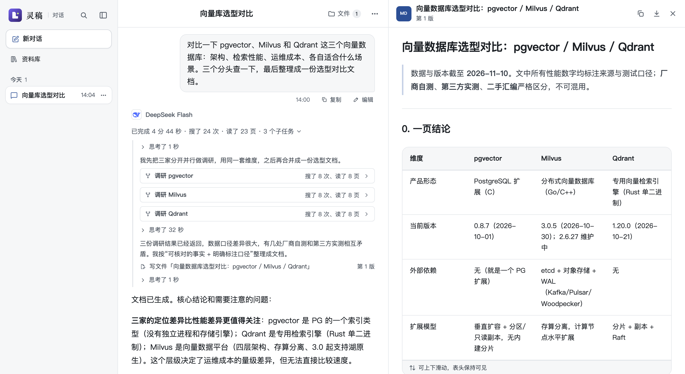
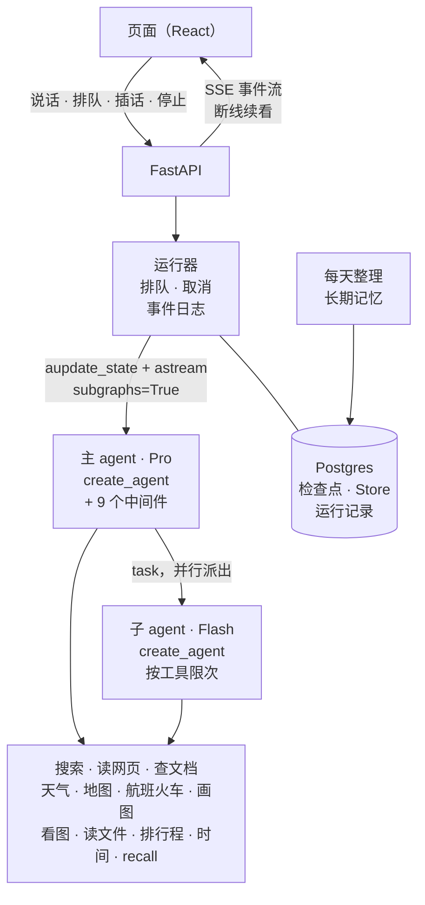

# 灵稿 · LingDraft

从一个想法，到一份拿得出手的作品。

一个能搜、能读、回答会标来源的 AI 对话 agent，基于 LangGraph 和 DeepSeek。主 agent 和子 agent 都是 LangChain 的 `create_agent`，上面挂着自己写的 9 个中间件。运行层也是自己写的，管排队、停止、插话和断线续看。检查点、长期记忆和运行记录都存在 Postgres。



## 架构



## LangGraph 在这里怎么用

| 机制 | 用在哪 |
|---|---|
| `create_agent` + `AgentMiddleware` | 主 agent、子 agent 都由它搭；12 个自写中间件用到 `before_agent`、`abefore_model`、`awrap_model_call`、`awrap_tool_call`、`after_model`（`can_jump_to`）、`after_agent` |
| `ExtendedModelResponse` + `Command(update=…)` | 中间件在一次模型调用里顺手改 state：写上起好的标题、换掉没通过审核的工具结果 |
| `context_schema` / `ToolRuntime` | 取插话、上次起好的标题这些运行时的东西从 context 传给中间件，不进 state；子任务、recall 工具从 `ToolRuntime` 拿 state 和 context |
| `aupdate_state(as_node=START)` + `astream(None)` | 用户的话先写进检查点再开跑，排队时服务重启也不丢 |
| `stream_mode=["messages", "updates", "custom"]`，`subgraphs=True` | 逐字的思考和正文、存下的步骤、工具进度一路推给页面；子 agent 的流按命名空间认出是哪个子任务的 |
| `get_stream_writer` / `TAG_NOSTREAM` | 中间件推自定义事件（在等什么、工具进度）；写短版、单条送审这些内部调用不推给页面 |
| `langchain.mcp`（`MCPAdapter`） | 搜索、读网页、天气、地图、航班火车、画图、查文档（Context7）都是 agent-tools 的 MCP 工具，怎么搜、怎么读、挑城市、定地名、查班次、出图存图、结果的样子和失败时给模型的话都在服务里，几个产品共用：灵稿起服务时取来，工具说明后面接上自己的一段，中间件给搜索结果、读到的页、查到的每段文档带上来源 id，管每轮画几张查几次、比路线时核对车站的城市；天气、地图、航班火车、画图结果的 `structuredContent` 画卡片，模型只看文字（图只给编号，页面经灵稿后端按编号取）；排行程是灵稿自己的工具，模型按查到的班次编号排，核对过才画行程卡 |
| `ToolMessage.artifact` | 子 agent 的整段消息放在 artifact 里交回：来源、用量、子任务卡从这里读，主 agent 的模型只看报告 |
| `ToolCallLimitMiddleware` | 子 agent 搜、读各 8 次的硬上限 |
| `AsyncPostgresSaver`，`durability="exit"` | 检查点只在一轮的开头和结尾存 |
| `AsyncPostgresStore` | 长期记忆；和检查点、运行记录共用一个连接池 |
| `StateGraph` + `interrupt` / `Command(resume=…)` | 早先的海报场景：手写图，生成前后停下来让人确认 |
| `InMemorySaver` / `InMemoryStore` | 测试 |

## 几个工程决定

**运行层自己写，对照 Agent Server。** 一个对话同时只跑一轮。停止就是取消这一轮的任务，在等的模型、搜索一起断开。事件先写进事件日志，断线后带着最后一个事件 id 续看。回答时用户又说的话可以排队，等这一轮答完再发；也可以插进正在跑的这一轮，下一次调模型之前放进对话。插进这一轮是 Agent Server 没有的。

**检查点只存开头和结尾。** 默认每一步都存一份整段对话，存储随对话长度按平方增长。改成 `durability="exit"` 后，12 轮的对话从 156 个检查点、4.5MB 降到 36 个、1.1MB。代价是被掐断的那一轮要整轮重跑。

**上下文压缩围着前缀缓存设计。** DeepSeek 命中缓存的输入只要 1/30 的价钱。LangChain 现成的两种压缩每次都改开头，算下来摘要贵 11%、清工具结果贵 27%，摘要还会把页面上的历史一起删掉。所以自己写：

- 压到哪一轮存在 state 里、只往后挪，两次挪动之间发出去的前缀逐字不变；
- 先把旧的工具结果换成带来源 id 的一行说明，还超才把整轮换成短版，原文用 `recall` 取回；
- 只改发给模型的那一份，页面照常显示原文。

算账时还查出每轮都丢了上一轮的缓存，28%～30% 没命中的输入是白算的，也一起修了。

**子 agent 的用量靠代码管，不靠提示词。** 主 agent 用 `task` 工具一次派几个子 agent 并行去查：每轮最多 5 个，同时最多跑 3 个。评测发现，提示词里“够了就停”那几句 Flash 根本不照做，加不加平均都搜 8 次左右。改成每一步告诉它还剩几次，再加按工具的硬上限。一个三城对比的问题，花费降了 30%，用时降了 32%。

**长期记忆每天整理一次。** Store 不跟检查点一起提交，边聊边存的话，重新回答、删对话都撤不回已经存进去的记忆。记忆放进系统提示词，一变前缀缓存就断。所以对话里不存，每天凌晨 3 点（闲时价）把有新内容的对话整理一遍：模型对照全部现有记忆增、改、删，记忆一天只变一次。

**用户发的文件不卡对话、不拖垮容器。** 选好就传，在单独的子进程里解析，对话照常进行：容器只有 512MB，子进程最先被 OOM 杀掉，60 秒超时，出了事只是这个文件读不了。本机测一份 16MB、26 万行的 Excel，解析 4 秒，子进程峰值约 150MB。2 万字以内的文件整篇给模型（一句话合计不超过 5 万字），长的只给目录和开头，模型用 `read_file` 按页读、在文件里找。文件内容不存进消息，每次调模型时按存下的文字现拼，拼出来逐字不变，前缀缓存照常命中。

**模型出错分两类处理。** 服务不可用走熔断：同一个模型连续 2 次不可用就断开 180 秒，429 不计入，不然请求一密就把所有对话一起断开。内容审核拦下时，把新加进来的工具结果逐条送审，只去掉没通过的再试；拦下的是用户的话就停下这一轮。

## 评测

用真实模型回放多轮对话（`backend/evals/`），每一轮查三样：

- 轨迹：该不该搜、该不该读原文、引用的来源在不在；
- 回答：裁判模型按用例写的标准判；
- 引用：另一个裁判模型拿 agent 当时看到的材料，逐条核对带角标的说法有没有依据。

每次评测只回答一个具体问题，答到就停。

## 项目结构

```
.
├── backend/
│   ├── app/
│   │   ├── api/               FastAPI 接口；运行器（排队、停止、插话、事件日志）；运行记录
│   │   ├── graph/research/    对话 agent：create_agent 和中间件、子 agent、上下文压缩、长期记忆、提示词
│   │   ├── graph/poster/      海报场景：手写的 StateGraph
│   │   ├── files/             用户发的文件：认类型、子进程里解析、原件和文字怎么存
│   │   ├── tools/             搜索、读网页、查文档、天气、地图、航班火车和排行程、画图、看图、读文件
│   │   ├── evals/             回放评测：多轮驱动、裁判、引用核对
│   │   ├── research_llm.py    每一步用哪个模型；测试用的假模型
│   │   ├── model_guard.py     模型服务出错的分类和熔断
│   │   └── aio.py             对话 agent 跑在一个固定的后台事件循环里
│   ├── evals/research/        评测用例
│   └── tests/                 500 多个测试，只用假模型；CI 在内存和 Postgres 上各跑一遍
├── frontend/src/              对话页：对话列表、过程时间线、来源角标、天气卡片、地点和路线卡片、航班火车卡和行程卡、画的图、发的图和文件、记忆页
├── Dockerfile                 先构建前端再装后端，一个容器同时出接口和页面
└── docker-compose.yml
```

## 技术栈

- 后端：Python 3.12、FastAPI、LangGraph 1.2、LangChain 1.4、Postgres（psycopg 连接池）、uv
- 模型：默认 DeepSeek V4 Pro（主 agent、整理记忆）、Flash（子 agent、起标题、写短版）；输入框旁边还能选豆包、Kimi、千问、MiMo、GLM、混元、MiniMax
- 前端：React 18、Vite
- 部署：Docker Compose；GitHub Actions 跑测试，合并后自动部署

## 本地运行

```bash
cd backend
cp .env.example .env    # 填数据库地址和密钥；LINGDRAFT_FAKE=1 用假模型
uv sync
uv run uvicorn app.api.main:app --port 8000

# 另开一个终端
cd frontend
npm install
npm run dev             # http://localhost:5173
```

测试：`cd backend && uv run pytest -q`

接口、事件、环境变量、存储等开发说明见 [backend/README.md](backend/README.md)。
