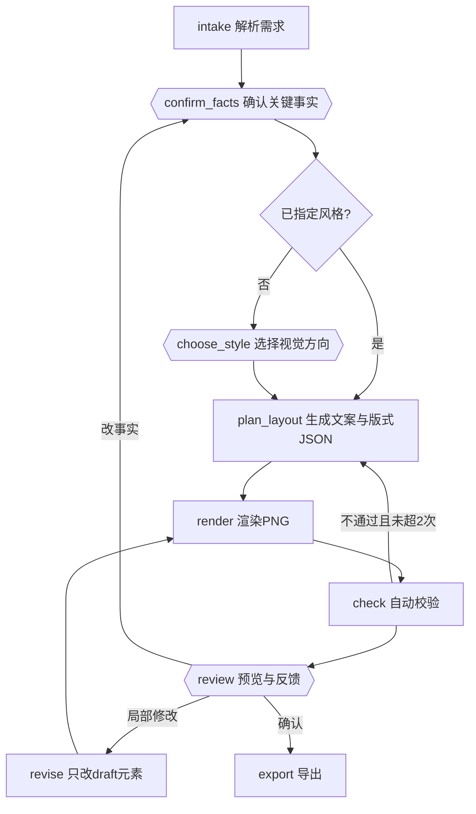

# 灵稿 · 黑五海报 PoC 技术方案

日期：2026-10-27　状态：待 Sean 确认

## 1. 目标与边界

**目标**：用"黑色星期五预热宣传海报"一个场景，跑通一条带 Human-in-the-loop 的创作链路，验证三件事：

1. 优惠信息（价格、折扣、日期、规则）在海报上准确呈现。
2. 换标题或改风格时，不破坏已确认的内容（商品图、优惠信息、其他元素）。
3. 最终文件方便继续使用（可编辑、可导出）。

**明确不做**：PPT 与调研场景、品牌库管理、多渠道尺寸延展、像素级局部重绘（inpaint）、用户体系、部署、模型输出质量调优。

**核心体验目标**：帮助用户把资料做成可交付的作品，并在反复修改中保住已确认的信息和内容。

## 2. 三个关键设计决策

### 决策 A：关键事实是结构化字段，不是文案的一部分

价格、折扣、日期、商品名、活动规则由用户填写或确认后，以 `Fact` 字段存入 LangGraph state。海报上对应元素**绑定到字段**，渲染时直接取值。LLM 只写标题、副标题、行动号召（CTA）这类创意文案，不允许生成或改写事实字段。

这一条直接决定了验收项 1。它也是"换标题不改优惠"的前提：标题是 draft 元素，优惠是事实绑定元素，二者在 state 里本来就是两类东西。

### 决策 B：LLM 输出版式 JSON，不写 HTML

LLM 产出的是"槽位填充 + 版式选择"的结构化 JSON（参考 CreatiPoster 的分层协议字段）。渲染由固定模板完成：JSON → HTML/CSS 模板 → Playwright 截图 PNG。

Codex 指出"WorkBuddy 的 HTML 海报返工多"不能推出"HTML 不能做海报"。本方案采用 HTML 作为渲染层，但与 WorkBuddy 通用 Agent 路径的区别在于：**模型不碰 HTML**。模板槽位固定、尺寸固定、溢出由模板规则处理（固定文本框 + 自动缩字），局部修改只改 JSON 再重渲染，不需要模型重新"写页面"。这满足 Codex 提出的四条要求：结构化元素、稳定布局约束、局部更新、可靠导出。

PoC 阶段背景图默认用模板内置的纯色/渐变，图像模型生成背景作为可选开关（只生成无文字的背景，文字永远是文字层）。商品图由用户上传，作为独立图层放置，不经过任何 AI 改动。

### 决策 C："保留已确认内容"是显式状态机，不是 prompt 里的一句话

每个元素带 `status: draft | confirmed | user_edited`。规则：

- 用户在预览时针对元素 X 提修改，其余元素自动转为 `confirmed`（用户看过且未提异议）。
- 修改节点只允许改 `draft` 元素；`confirmed` 与 `user_edited` 元素原样透传，事实绑定元素永远不可由模型改动。
- 用户要改事实（例如折扣从 5 折改成 6 折），必须回到事实确认节点，走显式确认，而不是在修改指令里顺带改掉。
- 用户手工编辑某元素内容，该元素转为 `user_edited`，之后模型不再动它。

每一轮生成或修改产生一个版本快照，可回退。

## 3. 流程与确认点



双花括号的节点是 `interrupt()` 确认点，共三个：

| 确认点 | 用户看到什么 | 用户回什么 | 跳过条件 |
|---|---|---|---|
| confirm_facts | 事实卡片：商品名、优惠、日期、CTA、尺寸，已有值预填、缺失项标红 | 修改后的字段值，提交即全部 `confirmed` | 不可跳过，这是验收项 1 的根基 |
| choose_style | 3 个风格选项（名称、配色、氛围、一句描述）+ 自由补充 | 选项 id 或自由文本 | 用户在需求里已明确风格则跳过，由 state 判定而非模型判定 |
| review | 预览图 + 元素列表 + 版本列表 | `approve` / `edit(target, instruction)` / `manual_edit(element, content)` / `change_fact` | 不可跳过 |

只问这三处，对应简介里"只问返工成本高的信息"。三处确认都由图结构决定，同一需求每次运行得到同样的检查点，这是与 WorkBuddy 海报路径的差异。

## 4. State 设计

```python
class Fact(BaseModel):
    key: str              # product_name / offer / date_range / cta / rules
    label: str
    value: str | None
    source: Literal["user", "inferred"]
    status: Literal["draft", "confirmed"]
    required: bool

class StyleOption(BaseModel):
    id: str
    name: str
    palette: list[str]
    mood: str
    description: str

class Element(BaseModel):
    id: str
    kind: Literal["headline", "subhead", "offer", "date", "cta",
                  "product_image", "logo", "background", "decor"]
    content: str | None    # 文本内容或图片路径
    bound_fact: str | None # 绑定的 Fact.key，有则 content 由渲染时取值
    slot: str              # 模板槽位名
    style: dict            # 字号、颜色等，受模板约束
    status: Literal["draft", "confirmed", "user_edited"]
    version: int

class Version(BaseModel):
    n: int
    elements: list[Element]
    png_path: str
    note: str              # 本轮改了什么

class PosterState(TypedDict):
    messages: Annotated[list, add_messages]
    facts: dict[str, Fact]
    style: StyleOption | None
    style_options: list[StyleOption]
    template_id: str
    elements: list[Element]
    versions: list[Version]
    pending_action: dict | None   # review 的 resume 载荷
    check_results: list[dict]
    retry_count: int
```

事实、风格、元素、版本都在 state 里，messages 只作对话记录，不承担状态。

## 5. 节点职责

| 节点 | 是否调用模型 | 做什么 |
|---|---|---|
| intake | 是，结构化输出 | 从用户首句提取事实到 `facts`（标 `inferred`/`draft`），识别是否已指定风格 |
| confirm_facts | 否 | 仅 `interrupt()`，把 facts 表单发给前端；resume 后写回并置 `confirmed` |
| choose_style | 是 + interrupt | 先生成 3 个 `StyleOption`，再 `interrupt()` 让用户选；生成与中断拆为两个节点，避免 resume 时重跑生成 |
| plan_layout | 是，结构化输出 | 选模板，为每个槽位写文案；事实槽位只输出 `bound_fact`，不输出内容 |
| render | 否 | elements + facts → Jinja2 模板 → Playwright 截图；写入新 Version |
| check | 否 | 事实绑定元素文本与 fact 值逐字比对；违禁词表（绝对化用语）；DOM 测量溢出；不通过则带约束回 plan_layout，最多 2 次 |
| review | 否 | 仅 `interrupt()`，发预览与元素列表；resume 得到 `pending_action` |
| revise | 是，结构化输出 | 按 `pending_action` 只重写目标 `draft` 元素；输入里明确列出哪些元素被锁定 |
| export | 否 | 输出 PNG、HTML、`brief.json`（事实与元素清单）、版本历史 |

## 6. LangGraph 落地要点

- **版本**：LangGraph 1.x，LangChain 1.x。`interrupt()` / `Command(resume=...)` 是 1.0 的稳定 API，`interrupt_before/after` 静态断点不用于业务确认。
- **一个节点一个 interrupt**：resume 时节点从头重跑，所以模型调用与 interrupt 必须拆到不同节点（choose_style 拆成 `gen_style_options` 和 `ask_style`）。
- **resume 校验**：`interrupt(value, response_schema=FactsForm)` 对用户回传做 Pydantic 校验（`langgraph>=1.2.12`）。表单 schema 采用 MCP elicitation 风格的扁平结构（单选 `oneOf`+`title`、`default`），前端一套渲染器。
- **持久化**：`SqliteSaver`，`thread_id` = 一张海报任务。验收时要演示进程重启后 resume 成功。
- **幂等**：render 用 version 号命名输出文件，重跑不覆盖。
- **流式**：`stream_mode=["updates", "custom"]`，节点内 `get_stream_writer()` 推"渲染中 / 校验中 / 第 n 版已生成"事件。
- **LangChain `create_agent`**：海报链路没有需要模型自主调用工具的环节，PoC 不引入。调研场景接入时再用。
- **结构化输出**：方舟 Chat API 支持 `response_format: {type: "json_schema", json_schema: {name, strict: true, schema}}`，官方标注 beta，推荐 json_schema 模式。LangChain 侧用 `ChatOpenAI(...).with_structured_output(Schema, method="json_schema", strict=True)`，M1 第一天实测 `langchain-openai` 发出的请求体与方舟兼容。
- **深度思考默认开启**：豆包 Seed 2.x 默认启用深度思考。intake / plan_layout / revise 三处结构化调用通过 `extra_body={"thinking": {"type": "disabled"}}` 关闭，降低延迟与成本。方舟文档还要求结构化输出不要与 `frequency_penalty` / `presence_penalty` 同用。
- **Schema 约束**：方舟 strict 模式支持 `type / enum / anyOf / $ref(本地) / required / additionalProperties` 等，不支持的关键字会报错。Element 与 Fact 的 Pydantic 模型保持扁平，`required` 配 `additionalProperties: false`。

## 7. 模型与渲染选型

| 项 | PoC 选择 | 备注 |
|---|---|---|
| LLM | 豆包 `doubao-seed-2-1-pro-260915`，经火山方舟 OpenAI 兼容接口 | 官方示例即 `langchain-openai` 的 `ChatOpenAI`，base_url `https://ark.cn-beijing.volces.com/api/v3`，密钥 `ARK_API_KEY`；intake 这类简单抽取可降到 `doubao-seed-2-1-lite-260915` |
| 结构化输出 | 方舟 json_schema 模式 + Pydantic | intake / plan_layout / revise 三处，关闭深度思考 |
| 背景图 | 模板内置纯色/渐变 | 开关打开时用 Seedream `doubao-seedream-5-0-flash-260915` 生成无文字背景，同一把方舟密钥，端点 `/api/v3/images/generations`；默认关 |
| 渲染 | Jinja2 + Playwright Chromium | 1080×1440 单尺寸，2 到 3 套模板 |
| 导出 | PNG + HTML + brief.json | HTML 可直接改字；SVG 留后续 |
| 校验 | DOM 比对 + 词表 + 溢出测量 | 不做 OCR，文字本来就是从 JSON 来的 |

模型接入写法（来自方舟官方"兼容 OpenAI SDK"页，2026-10-09 更新）：

```python
from langchain_openai import ChatOpenAI

llm = ChatOpenAI(
    base_url="https://ark.cn-beijing.volces.com/api/v3",
    api_key=os.environ["ARK_API_KEY"],
    model="doubao-seed-2-1-pro-260915",
    extra_body={"thinking": {"type": "disabled"}},
)
planner = llm.with_structured_output(LayoutPlan, method="json_schema", strict=True)
```

方舟模型列表（2026-10-24 更新）中 `doubao-seed-2-1-pro-260915` 与 `doubao-seed-2-1-lite-260915` 均标注支持工具调用与结构化输出，上下文 1024k。

## 8. 前端与接口

PoC 前端做到最薄：一个 React 页面（Vite），四块区域：对话与进度、确认卡片（事实表单 / 风格选项 / 反馈表单）、预览图、版本列表。

后端 FastAPI：

| 接口 | 作用 |
|---|---|
| `POST /threads` | 新建任务，返回 `thread_id` |
| `POST /threads/{id}/run` | 发送用户输入，SSE 流式返回进度与 interrupt 载荷 |
| `POST /threads/{id}/resume` | 回传确认点答案，继续 SSE |
| `GET /threads/{id}/state` | 读取当前 facts / elements / versions |
| `GET /threads/{id}/versions/{n}.png` | 预览图 |
| `GET /threads/{id}/export` | 导出包 |

不引入 CopilotKit / AG-UI。调研发现 CopilotKit 文档对 LangGraph Python interrupt 的支持前后矛盾，PoC 阶段手写 SSE 更可控，接口形态与 AG-UI 事件保持兼容，后续可替换。

## 9. 验收用例

全部在黑五海报案例上执行：

| 编号 | 用例 | 判定 |
|---|---|---|
| T1 | 输入"某品牌蓝牙耳机黑五预热，5 折，11.20 到 11.27"，确认事实后生成 | 渲染元素文本与 confirmed facts 逐字一致；check 通过 |
| T2 | 在 review 回"标题换成更有紧迫感的" | 版本 diff 只有 headline 元素变化；PNG 在 headline 框外像素差为 0 |
| T3 | 在 review 回"整体换成深色" | 文案元素内容不变，仅 style 变化；事实元素文本不变 |
| T4 | 手工改副标题后再让模型改标题 | 副标题保持 `user_edited`，内容不变 |
| T5 | 要求"折扣改成 6 折" | 流程回到 confirm_facts 显式确认，不在 revise 里静默改 |
| T6 | 事实确认后杀掉后端进程再启动，resume | 从 SQLite 恢复到同一确认点继续 |
| T7 | 导出 | PNG 可用；HTML 打开后可直接改字；brief.json 包含全部事实与元素状态 |
| T8 | 需求里已写明"极简白底风格" | 不出现 choose_style 确认点 |

T1、T2、T7 对应三条核心验收；其余验证 HITL 机制本身。

## 10. 目录结构

```
lingdraft/
  backend/
    app/
      graph/poster/   state.py  nodes.py  graph.py  prompts.py
      render/         templates/  renderer.py  checks.py  forbidden_words.txt
      api/            main.py  sse.py
    tests/            test_graph_hitl.py  test_render.py  test_preserve.py
    pyproject.toml
  frontend/           Vite + React，单页
  docs/               本方案
```

## 11. 里程碑

| 阶段 | 产出 | 验收 |
|---|---|---|
| M1 | 图 + 渲染 + 校验，命令行驱动 resume，无前端 | T1、T2、T5、T6 用 pytest 通过 |
| M2 | FastAPI + SSE + 最薄 React 页面 | 三个确认点在页面上可操作，T3、T4、T8 通过 |
| M3 | 黑五案例完整走一遍并录屏 | T7 通过，形成 PoC 结论 |

每个里程碑按全局约定自审、跑测试后合并。

## 12. 待 Sean 拍板

1. 背景图：PoC 是否打开 Seedream 生成背景？已统一用豆包，接入成本低，但会给验收引入一个不确定因素，建议 M1 关、M2 作为开关打开。
2. 前端：接受"最薄 React 页面"，还是 M1、M2 都先用命令行和 LangGraph Studio 看效果，前端放到 M3？

已定：模型统一用豆包（2026-10-27）。

## 13. 风险

- 方舟结构化输出仍是 beta，官方提示可用性可能随负载波动。M1 第一天实测 `langchain-openai` 的 json_schema 路径；若不稳定，退化为 json_object 模式加 Pydantic 校验重试。
- 模板自动缩字处理超长文案有上限，check 溢出不通过时回 plan_layout 要求缩短文案，最多两次。
- "其余元素自动 confirmed"的规则可能过于激进，用户只是没注意到某处。PoC 先这么做，版本回退兜底，验收后再看是否需要显式勾选。

## 12. M1 实施记录（2026-10-27）

已落地 `backend/`，16 个 pytest 用例全部通过（FakePlanner，不联网）。与第 4～6 节相比的实现调整：

- **confirmed 元素可被点名修改**：用户对元素 X 下 `edit` 指令时，X 即使已是 confirmed 也会重新打开为 draft 再交给模型；只有 `user_edited` 和事实绑定元素拒绝模型改写。原方案"revise 只碰 draft"在"改副标题后再改标题"这种常见路径上会把标题永久锁死。
- **风格自定义不在中断节点调模型**：`ask_style` 收到自定义描述后只写入 `style_hint`，路由回 `gen_style_options` 生成；避免 interrupt 节点内 LLM 失败导致重跑语义不清。
- **render 的版本备注由上游节点写 `render_reason`**，不再从 `pending_action` 推断。
- **cta 是唯一可选事实**：事后补填 cta 会把 cta 元素改为事实绑定；清空则解绑并保留原文字为 draft。
- **自动缩字有下限**（标题 72px、副标题 30px 等），低于下限判溢出，带"缩短文案"约束回 `plan_layout`，最多 2 次；仍失败则把校验结果如实带进 review。
- **manual_edit / revise 对未知或不可改目标不产生新版本**，直接带提示回到 review。
- 检查点里的 Pydantic 模型通过 `JsonPlusSerializer(allowed_msgpack_modules=...)` 显式放行，避免 LangGraph 未来版本拒绝反序列化。

未验证：`ArkPlanner` 对豆包的 `json_schema` 结构化输出路径尚未实测（本机无 `ARK_API_KEY`），这是 M2 开始前的第一件事。

## 13. M2 实施记录（2026-10-27）

- 新增 review 动作 `change_style`：清空当前风格回到 `ask_style`（或带描述直接 `gen_style_options`），之后经 `gen_background` 直接 `render`，不重新写文案；元素内容、状态、版本号全部不变（T3）。
- 新增节点 `gen_background`：按风格调 Seedream 生成无文字背景（`LINGDRAFT_BACKGROUND=0` 可关），模板在生成图上压一层同色渐变保证文字区可读。FakePlanner 用 Pillow 画渐变代替。
- FastAPI：`POST /api/threads`、`POST /api/threads/{id}/resume` 以 SSE 推送节点进度、interrupt 载荷和最终状态；`GET state / files / export`。图执行放在单个工作线程（Playwright 同步 API 绑定线程），用锁串行。
- 前端：一个 `App.jsx`，按 interrupt 类型切换表单；元素列表显示 草稿 / 已确认 / 手工编辑 / 事实绑定 四种徽标，事实绑定元素只给"改事实"按钮。
- 浏览器实测（假模型）：需求 → 确认事实 → 选风格 → 初稿 → 改标题 v2 → 换风格 v3 → 导出 zip，全程无前端报错。

未验证：豆包文本与 Seedream 图片接口都未真实调用；`images.generate` 的 `size="1080x1440"` 与 `watermark` 参数是按文档写的，首次联调时要确认。

## 14. M3 实施记录（2026-10-27）：真实模型联调

全部走通，耗时与结果：

| 调用 | 模型 | 耗时 | 结果 |
|---|---|---|---|
| intake 结构化提取 | doubao-seed-2-1-lite，json_schema strict | 1.5～3 s | 需求里没有的字段返回 null，不编造 |
| 三个风格方向 | doubao-seed-2-1-pro | 10～11 s | 名称、4 色、氛围、描述齐全 |
| 指定风格描述 | pro | 2.7 s | 1 个方向 |
| 初稿文案 / 改标题 | pro | 2～3 s | 只回传目标槽位 |
| 背景图 | doubao-seedream-5-0-flash，1080x1440 | 14 s | 无文字，参数 `size="1080x1440"`、`watermark: false` 有效 |

完整案例（CLI，thread `m3real`）：需求 → 确认事实 → 选风格 → v1 → 改标题 v2 → 手工改副标题 v3 → change_fact 改成 6 折 v4 → 导出；每一步的元素状态与第 4 节约定一致。浏览器录屏（真实模型）见 `docs/demo/lingdraft_blackfriday_poster_demo.gif`，成品见 `docs/demo/*.png`。

联调中发现并修掉的两个问题：

1. **文案里复述事实**。模型会把“5折”“11.20至11.27”写进标题 / 副标题，事实一改这些数字就过期。处理：提示词明确“数字只在事实槽位出现”，并新增确定性校验 `no_numbers_in_copy`（自由文案含任何数字即不通过，带约束重试）。代价是“双11”这类合法数字也会被拦，PoC 接受。
2. **背景图里画出了商品**。Seedream 按“与商品相关的虚化元素”画了一副并不存在的耳机，等于编造产品外观。处理：背景提示词改为纯抽象光影、明确不画任何具体物体，商品图只能来自用户上传；有背景图时不再显示中央虚线占位框。

仍待观察：风格生成 10 s 左右偏慢（Seed 2.x 已关 thinking），后续可改用 lite 或流式；浏览器端 SSE 等待期间没有逐节点的"正在生成背景图…"提示，只有日志。
